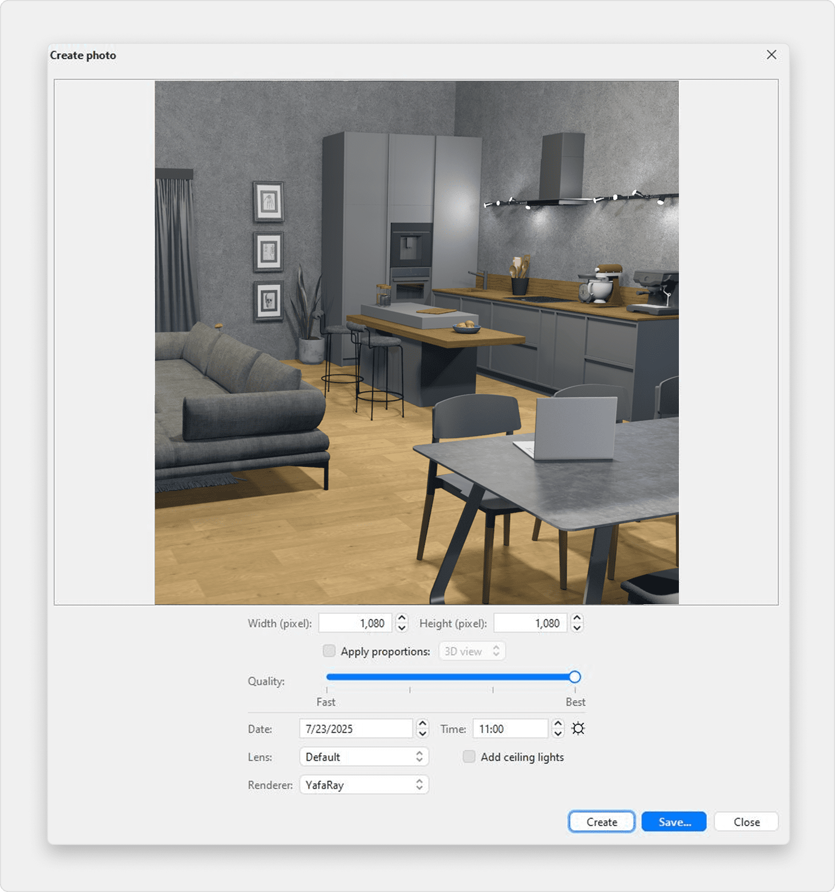
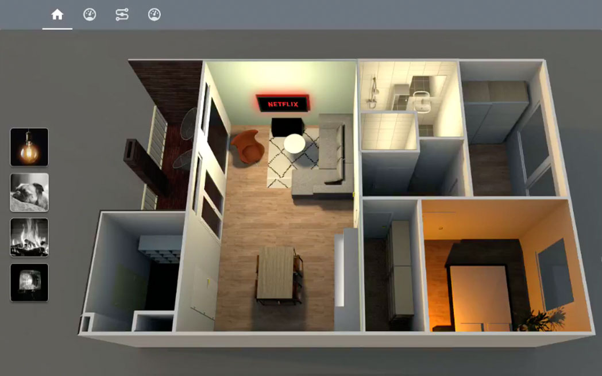

# Sweet Home 3D Interior Layouts at Real Scale

Choose sweet home 3d models that match the furniture you intend to place, then judge their size in a measured room.
Sweet Home 3D combines a 2D floor plan with a 3D view, so layout decisions can be checked from both perspectives.
This guide focuses on the desktop edition of sweet home 3d software.

[](https://sweet-home-3d-models.github.io/Sweet-Home-3d/)

## Build a catalog that represents your furniture

A convincing model is useful only when its dimensions and orientation describe the intended object.
Start with a small set of relevant pieces rather than filling the catalog with unrelated assets.

- Record the real width, depth, and height before importing an unfamiliar model.
- Give similar pieces distinct names, such as a two-seat sofa and a three-seat sofa.
- Check the front direction and the elevation above the floor.
- Keep the model's accompanying materials and textures with the source asset.
- Retain the source and license information for models you plan to share.

The [model library guide](https://www.sweethome3d.com/import-models/) explains individual models and SH3F furniture libraries.
SH3F libraries package multiple catalog entries with their descriptions.
Importing a furniture library and opening a home document serve different purposes.

The sweet home 3d open source project also provides a Furniture Library Editor for maintaining catalog collections.
Use the [official resource page](https://www.sweethome3d.com/download/) to distinguish the application, library editors, and executable JAR.

## Anchor furniture to a measured floor plan

A sweet home 3d floor plan should establish the room envelope before decorative details compete for attention.
If tracing a background image, calibrate its scale against a known measurement.
Check another measured distance before trusting the rest of the drawing.

Place walls, doors, and windows, then position the furniture that defines how the room will be used.
A sofa, bed, or dining table often determines the circulation more strongly than smaller accessories.



### Compare position with usable space

Look beyond whether a piece fits inside the room boundary.
Allow room for doors to open, chairs to move, and people to pass.
Try the intended arrangement from the visitor's viewpoint as well as from above.

Keep alternate arrangements in separately named project copies.
Change one major placement at a time so the reason for a better layout remains visible.
Use measured clearances for purchasing decisions; a perspective view alone can hide a tight passage.

## Choose the correct asset for each operation

The [desktop user guide](https://www.sweethome3d.com/users-guide/) describes the supported model formats and export workflow.
File extensions distinguish editable home documents, catalog libraries, and geometry exchanged with other applications.

| Asset | Contains | Used for |
| --- | --- | --- |
| SH3D home | Editable home project | Continuing the layout later |
| SH3F library | Furniture models and catalog descriptions | Adding a reusable furniture collection |
| OBJ or DAE model | Imported object geometry | Creating an individual furniture entry |
| 3DS or KMZ model | Another supported model representation | Importing compatible furniture assets |
| OBJ export with MTL and images | Visible scene geometry, materials, and textures | Reusing the scene in another 3D application |

Use Furniture > Import furniture to choose a model and review its orientation and size.
Check a newly imported piece in a simple room before adding it to a large furnished project.
A successful import does not establish that the dimensions match the real product.


## Inspect furniture dimensions through the Java API

For plug-in authors, the document model exposes furniture entries through Home.getFurniture().
The [HomePieceOfFurniture API](https://www.sweethome3d.com/javadoc/com/eteks/sweethome3d/model/HomePieceOfFurniture.html) exposes names and dimensions.

This helper belongs inside a Java class compiled against the Sweet Home 3D API.
Call it with the home supplied by a plug-in; it prints width, depth, and height in centimeters.

```java
import com.eteks.sweethome3d.model.Home;
import com.eteks.sweethome3d.model.HomePieceOfFurniture;

public static void printFurnitureSizes(Home home) {
    for (HomePieceOfFurniture item : home.getFurniture()) {
        System.out.printf("%s: %.1f x %.1f x %.1f%n",
            item.getName(), item.getWidth(),
            item.getDepth(), item.getHeight());
    }
}
```

The helper reads document data without changing the layout.
It reports top-level entries, including groups, rather than recursively listing every grouped component.
These dimensions describe the object itself; they are not a calculation of walking clearance.
The [plug-in developer guide](https://www.sweethome3d.com/plug-in-developers-guide/) explains how Java extensions integrate with the application.

## Examine the supplied FreeCAD reference material

FreeCAD's [documents-and-geometry.md](contrib/guidelines/documents-and-geometry.md) discusses persistence, recompute, and geometric references.
Its [gui-and-translations.md](contrib/guidelines/gui-and-translations.md) addresses interaction behavior, while [testing-and-validation.md](contrib/guidelines/testing-and-validation.md) covers validation.
The visual-test utility [manage_coin_node_baselines.py](tools/rendering/manage_coin_node_baselines.py) manages Coin node snapshot baselines.

For implementation context, [architecture.md](contrib/guidelines/architecture.md) explains ownership across application layers.
[code-reuse.md](contrib/guidelines/code-reuse.md) discusses extending existing implementations, and [writing-code.md](contrib/guidelines/writing-code.md) covers maintainable changes.
[reviewing-changes.md](contrib/guidelines/reviewing-changes.md) describes investigation and review; [design-proposals.md](contrib/guidelines/design-proposals.md) discusses design decisions.
The guide index is [README.md](contrib/guidelines/README.md).
[CONTRIBUTING.md](CONTRIBUTING.md) and [contributing-changes.md](contrib/guidelines/contributing-changes.md) describe the FreeCAD contribution process.

FreeCAD build references include [CMakePresets.json](CMakePresets.json) and the helper overview [README.md](cMake/FreeCAD_Helpers/README.md).
[SetupCoin3D.cmake](cMake/FreeCAD_Helpers/SetupCoin3D.cmake) configures Coin3D discovery.
[SetupOpenCasCade.cmake](cMake/FreeCAD_Helpers/SetupOpenCasCade.cmake) requests the geometry kernel located through [FindOCC.cmake](cMake/FindOCC.cmake).
[SetupQt.cmake](cMake/FreeCAD_Helpers/SetupQt.cmake) selects Qt components.
[SetupPython.cmake](cMake/FreeCAD_Helpers/SetupPython.cmake) finds Python, while [FindPySide6.cmake](cMake/FindPySide6.cmake) locates its Qt bindings.

## Keep detailed scenes responsive

Repeated high-detail furniture and large textures can make a home harder to work with.
Remove unused decorative detail before treating additional memory as the whole solution.
Save a revision before replacing many instances of an imported object.

For an already obtained executable JAR, Java can launch the desktop application with a chosen maximum heap:

```bash
java -Xmx2g -jar SweetHome3D-7.5.jar
```

Use the actual executable JAR filename and a compatible Java runtime.
The example allows up to 2 GiB for the Java heap; native graphics memory remains separate.
This is a Java launch command, not a batch rendering interface.
The named JAR is an example application artifact, not a file in the uploaded snapshot.

## Share a view and preserve the editable design

Save the home document before producing presentation images or exchanging geometry.
A still image communicates appearance, while the native project preserves the arrangement for later revision.

For desktop OBJ export, keep the generated MTL file and texture images alongside the OBJ.
Check the imported scene in the receiving application before relying on its materials.
Changing a material or light in another renderer does not update the original home automatically.



When comparing alternatives, use a similar viewpoint so furniture changes remain easy to assess.
Include a plan view when someone needs to understand dimensions or the relationship between rooms.

The uploaded snapshot contains FreeCAD reference files; Sweet Home 3D application sources and furniture libraries are absent.
Those supporting files describe a separate CAD project and are not Sweet Home 3D build instructions.
For the application's own source history, use the [official SourceForge repository](https://sourceforge.net/p/sweethome3d/code/HEAD/tree/).

## Related Search Terms

sweet home 3d models, sweet home 3d, sweet home 3d software, sweet home 3d open source, sweet home 3d floor plan, interior-design, floorplans, home-design, furniture, 3d-modeling, architecture, cad, java, rendering, open-source
